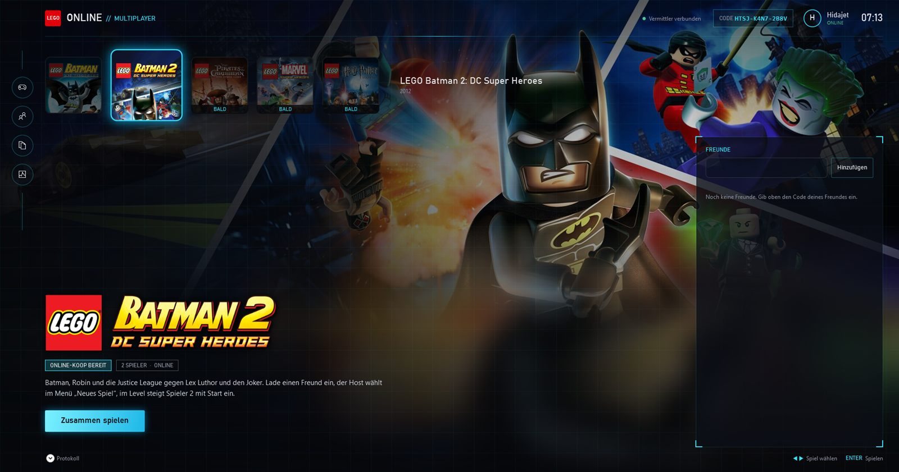
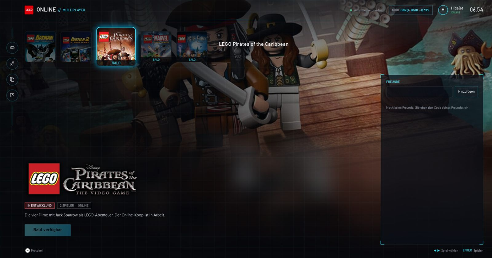

# Morgenbericht 20.10.2026

## Kurz

- **LEGO Batman 2 online:** Lokal laufen Host und Gast über alle 31.000 Testframes (Intro, Zwischensequenzen, erstes Level) in jedem Logikwert gleich. Es gab 0 Desyncs und ~59 fps. Fällt der Mitspieler weg, friert das Spiel nicht mehr endlos ein: Nach 30 s ohne jedes Lebenszeichen kommt ein Hinweis und du spielst allein weiter. Eine Pause (Alt-Tab, Ladehänger) löst das nicht aus.
- **Launcher:** neue Startseite im PS5-Stil mit Spielkacheln und Vollbild-Hintergrund. LEGO Batman 1 und 2 sind spielbar, Pirates of the Caribbean, Marvel Super Heroes und Harry Potter sind Platzhalter.
- **Zum Testen:** `dist-b2\LegoBatmanOnline.zip`. Dein laufendes `dist-neu` habe ich nicht angefasst.
- **Noch offen:** Batman 2 wurde noch nie zwischen zwei echten PCs getestet. Das geht nur mit deinem Kollegen.

## 1. Multiplayer LEGO Batman 2

### Ergebnis der Netztests (Host und Gast auf diesem PC)

| Lauf | Bedingung | Ergebnis |
|---|---|---|
| N20 | Gast mit künstlichem Netz-Zittern (0–20 ms je Frame) | alle Logikwerte gleich, 0 Desyncs |
| N21 | normal | alle Logikwerte gleich, 0 Desyncs, 59 fps in Zwischensequenzen und Level |
| N22 | Gast mitten im Level beendet | Host wartet 30 s, zeigt einen Hinweis und spielt allein weiter |
| N23 | Gast 40 s angehalten, danach beendet | kein falscher Abbruch während der Pause, danach weiter gleich; nach dem Beenden Abbruch nach 30 s |

„Logikwerte“ sind alle Zufallsgeneratoren, Figuren, Positionen beider Spieler und die Levelanker, Frame für Frame verglichen.

### Was über Nacht dazukam

- **Kein Einfrieren mehr bei Abbruch:** Ein eigener Thread schickt jede halbe Sekunde ein Lebenszeichen. Erst wenn 30 s gar nichts ankommt (Spiel beendet, Internet weg), gilt der Mitspieler als verloren. Dann steht Spieler 2 still, du spielst weiter und siehst ein Hinweisfenster. Batman 1 verhält sich wie bisher.
- **Hinweis bei Desync:** Laufen die Spiele auseinander (Prüfsumme alle 60 Frames), erscheint ein Fenster mit der Bitte, neu zu starten.
- **Rechengenauigkeit festgesetzt:** Wie bei Batman 1 setzt die Mod die FPU je Frame auf denselben Zustand. In den Tests war das nie nötig. Es schützt gegen Grafiktreiber oder Overlays, die das auf einem PC anders einstellen.
- **Reaktionszeit:** Die App misst den Ping und wählt die Eingabeverzögerung daraus: 2–10 Frames, bei üblichem DSL-Ping 3–4 Frames (50–67 ms). Daran habe ich nichts geändert, es ist ein guter Kompromiss zwischen direkt und ruckelfrei.

### Bekannte Grenzen

- **Erste Minute langsamer:** Logos und Titel laufen absichtlich langsamer (die ersten 320 Frames). Das verhindert einen seltenen Versatz im Intro. Beim Laden wird es ebenfalls kurz langsamer.
- **Ein seltener Wettlauf ist noch offen:** Im härtesten lokalen Test (eine Instanz ungebremst, die andere künstlich verzögert) liefen 4 von 5 Paaren komplett gleich. Beim fünften kippte ein Zufallswert bei Frame 14681, ausgelöst von der Ton-Uhr einer Zwischensequenz. In den normalen Netztests trat das nicht auf. Passiert es doch, zeigt das Spiel den Desync-Hinweis.
- **Vollbild:** Der Hinweis ist ein Windows-Fenster. Im exklusiven Vollbild minimiert sich das Spiel dabei, der Hinweis bleibt sichtbar. Schöner wäre eine Einblendung im Spiel (siehe nächste Schritte).
- **Spielstände bei Batman 2:** gibt es online weiterhin nicht („Ohne zu speichern fortfahren“).

## 2. Launcher

- **Vorlage:** Pinterest, Suche „game UI menu“. Ohne Anmeldung zeigt Pinterest nur die Vorschaubilder der Suchergebnisse; anmelden durfte ich mich nicht. Von 15 Ergebnissen waren zwei am futuristischsten: ein Sci-Fi-Einstellungsmenü mit runder Symbolleiste und ein holografisches Panel mit Eckwinkeln. Beides ist nachgebaut, dazu die PS5-Anordnung, die du wolltest.
- **Aufbau:** oben die Reihe quadratischer Spielkacheln. Die gewählte ist größer und leuchtet, dahinter liegt das Vollbild des Spiels mit Überblendung. Unten links stehen Logo, Status, Beschreibung und „Zusammen spielen“, rechts ein Glas-Panel mit Welten (Batman 1) und Freunden, oben Freundescode, Name und Uhr.
- **Bedienung:** Maus oder Pfeiltasten wählen das Spiel, Enter startet. Bei Batman 1 öffnet „Zusammen spielen“ die erste Welt mit einem Online-Freund (sonst „Neue Welt“). Bei Batman 2 öffnet sich eine Freundesauswahl, alternativ „Einladen“ direkt beim Freund. Das zuletzt gewählte Spiel merkt sich die App.
- **Bilder:** offizielle Steam-Shopgrafiken (Hero, Kapsel, Logo), in die EXE eingebettet.
- **Platzhalter:** Pirates, Marvel und Harry Potter haben Kachel, Hintergrund und Beschreibung, dazu den Status „IN ENTWICKLUNG“ und einen gesperrten Knopf „Bald verfügbar“.
- **Anleitung:** `release/ANLEITUNG.txt` beschreibt jetzt die neue Startseite.

## 3. Commits (main, gepusht)

- `a86f770` App: Launcher im PS5-Stil mit Spielauswahl
- `73795e8` Batman 2: Abbruchschutz im Netzmodus (Lebenszeichen, Hinweise, FPU)
- Doku: dieser Bericht, `docs/batman2-phase0.md` (Netztests), `docs/app.md` (Launcher), Anleitung

## 4. Vorschlag für heute

1. **Echter Test mit dem Kollegen:** Beide entpacken `dist-b2\LegoBatmanOnline.zip`, wählen LEGO Batman 2 und spielen das erste Level. Danach liegen die Logs unter `%LOCALAPPDATA%\LegoBatmanOnline\logs`. Steht dort kein „DESYNC“, ist Batman 2 online praktisch fertig.
2. **Hinweise im Spiel einblenden** statt per Windows-Fenster (über den vorhandenen Direct3D-Haken).
3. Den letzten seltenen Wettlauf (Ton-Uhr der Zwischensequenz, Frame 9530/14681) weiter eingrenzen, falls der echte Test Desyncs zeigt.
